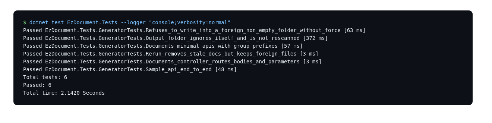
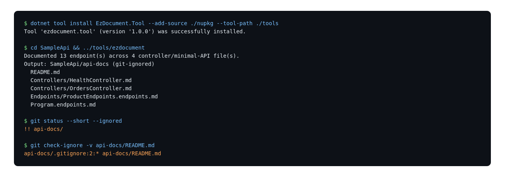
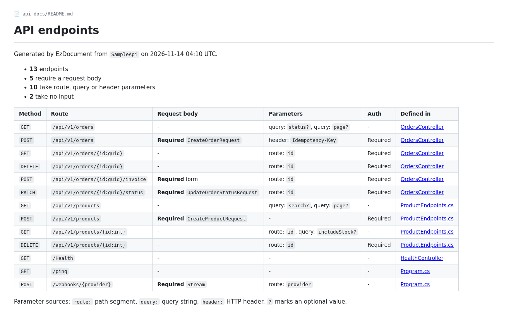
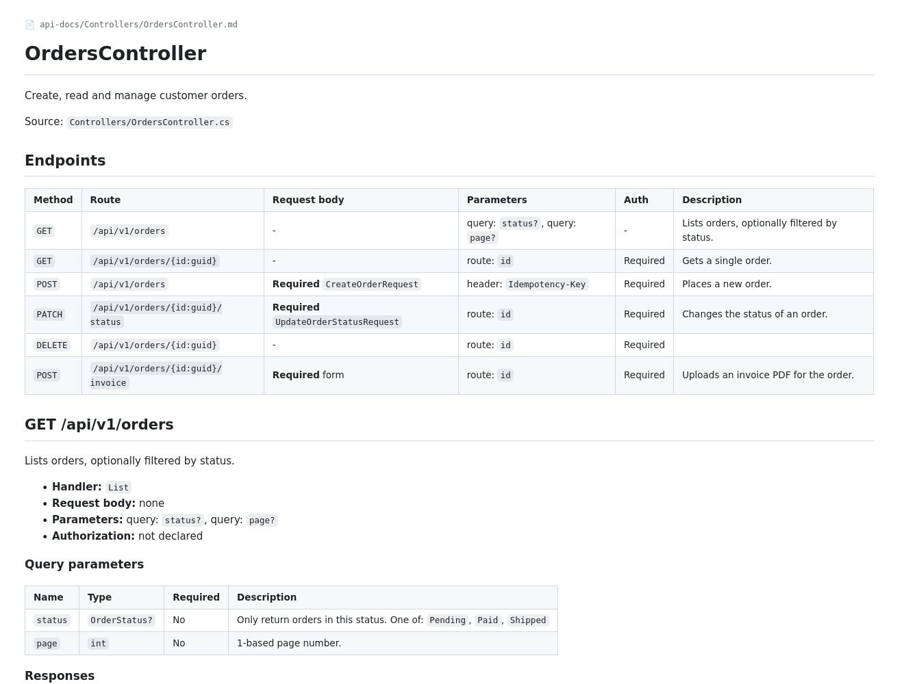
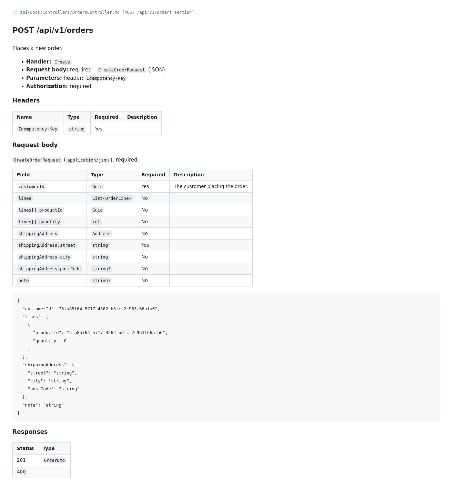
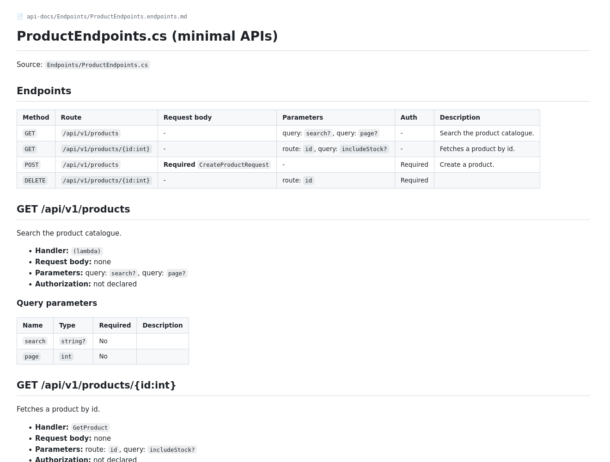

# EzDocument

EzDocument is a .NET tool (packaged on NuGet as `EzDocument.Tool`). It scans an ASP.NET Core codebase and writes **Markdown documentation for every endpoint**. For each route it says whether it needs a **request body** or **route/query/header parameters**.

It reads the C# source with Roslyn, so you don't need to build or run the project being documented.

## Install

From NuGet (once published):

```sh
dotnet tool install --global EzDocument.Tool
```

From a local build:

```sh
dotnet pack EzDocument/EzDocument.csproj -c Release        # writes ./nupkg/EzDocument.Tool.<version>.nupkg
dotnet tool install --global EzDocument.Tool --add-source ./nupkg
```

## Run

From the root of the solution or project you want to document:

```sh
ezdocument                                  # scans ., writes ./api-docs
ezdocument ./src/MyApi                      # scan a specific folder
ezdocument ./src/MyApi --output ./tmp/docs  # choose the output folder
```

| Option | Description |
| --- | --- |
| `-o, --output <dir>` | Output folder (default `<source>/api-docs`) |
| `-f, --force` | Write into an existing folder that EzDocument did not create |
| `-v, --version` | Print the version |
| `-h, --help` | Show help |

## Output

```
api-docs/
├── .gitignore                  # contains "*": the folder ignores itself, so docs are never committed
├── .ezdocument                 # manifest of generated files (used to clean up on the next run)
├── README.md                   # index: every endpoint, its body, parameters, auth, and a link
├── Controllers/OrdersController.md
└── Program.endpoints.md        # minimal APIs registered in Program.cs
```

The output folder is git-ignored by its own `.gitignore`, so you don't have to edit the host repository's `.gitignore`. On each run, EzDocument replaces only the files it generated last time. It never deletes files it didn't create, and it won't write into a non-empty folder it doesn't own unless you pass `--force`.

Each endpoint section contains:

- **Request body:** required, optional, or none. JSON bodies show the DTO's fields (nested, dotted paths), whether each field is required, the allowed values for enums, and a sample JSON payload. Form and file uploads are listed as `multipart/form-data` fields.
- **Parameters:** split into route, query and header, with types, whether they're required, and descriptions taken from XML `<param>` comments.
- **Authorization:** from `[Authorize]`/`[AllowAnonymous]` or `.RequireAuthorization()`.
- **Responses:** from `[ProducesResponseType]`, or the action's return type.

## What it understands

| Area | Supported |
| --- | --- |
| Controllers | `ControllerBase`/`Controller` subclasses, `[ApiController]` (including at assembly level), `*Controller` classes; skips `[NonController]`, `[NonAction]` and abstract classes |
| Routing | `[Route]` plus `[HttpGet]`/`[HttpPost]`/`[HttpPut]`/`[HttpPatch]`/`[HttpDelete]`/`[HttpHead]`/`[HttpOptions]`, `~/` overrides, `[controller]`/`[action]`/`[area]` tokens, `[ActionName]`, and the default conventional route for plain MVC controllers |
| Route constants | `[Route(ApiRoutes.Orders)]`, `const` concatenation, interpolated constants, `nameof()` |
| Minimal APIs | `MapGet`/`MapPost`/`MapPut`/`MapPatch`/`MapDelete`, nested `MapGroup` prefixes (including through variables), lambda and method-group handlers, `.WithSummary()`, `.RequireAuthorization()`, `[AsParameters]` |
| Binding | `[FromBody]`, `[FromQuery]`, `[FromRoute]`, `[FromHeader(Name=…)]`, `[FromForm]`, `[FromServices]`, `IFormFile`, `Stream`; when there's no attribute it follows ASP.NET Core's own rules (a name in the route template binds from the route, simple types from the query, complex types from the body) |
| Ignored parameters | `CancellationToken`, `HttpContext`, `ClaimsPrincipal`, `ILogger`, DI services |

**Limitations:** EzDocument reads syntax only. It can't see routes built at runtime, custom conventions, base-controller routes from other assemblies, or DTOs from referenced NuGet packages. Those show up as type names without field tables.

## Development

```sh
dotnet test EzDocument.Tests                           # unit + end-to-end tests
dotnet run --project EzDocument -- samples/SampleApi   # try it on the bundled sample API
```

## Screenshots

These come from a test run on 2026-11-14. I packed the `.nupkg`, installed it as a .NET tool, and ran it against the bundled [samples/SampleApi](samples/SampleApi) inside a fresh git repository.

**1. Test suite:** all 6 unit and end-to-end tests pass.



**2. Installing and running the packaged tool:** 13 endpoints documented, and git reports `api-docs/` as ignored by the folder's own `.gitignore`.



**3. Generated index (`api-docs/README.md`):** for each endpoint, whether it needs a request body, its route/query/header parameters, and whether it needs authorization.



**4. Controller page:** an `[ApiController]` with constant-based routes, plus query parameters showing the allowed enum values.



**5. Endpoint detail:** `POST /api/v1/orders` with a required header, the request body's fields (including nested ones), and a sample JSON payload.



**6. Minimal APIs:** `MapGroup` prefixes, `[AsParameters]` query binding, and `.RequireAuthorization()`.


